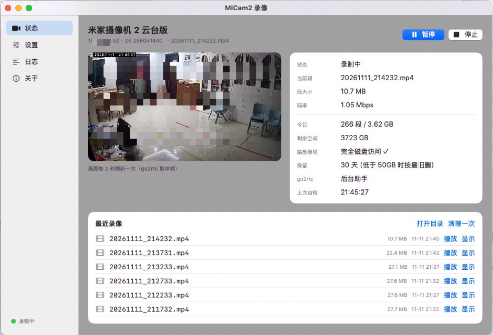

# MiCam2 — 小米智能摄像机 2 云台版，7×24 录像到 Mac 外置硬盘

[]() []() [](LICENSE)

> A native SwiftUI menu-bar app that records a Xiaomi smart camera (no flashing, no RTSP firmware hacks) to an external disk on a Mac, 24/7, with segment rotation, retention pruning and a watchdog.

不刷机、不拆机、不给摄像头装 RTSP 固件 —— 用小米云换来的局域网 P2P 通道取流，交给 ffmpeg 封装成 MP4，切片写到外置硬盘。全部功能收在一个原生 SwiftUI 菜单栏 app 里：开始 / 暂停 / 停止 / 删除、单帧预览、打开最近录像、可视化改配置、看门狗自愈。

- **动静分流**：有动作时 `ffmpeg -c copy`（2K 原流、CPU 极低）；画面静止时降为稀疏帧 + 低码率重编码（默认约 3 秒 1 帧），减轻外置盘持续写入。切换在**分段边界**进行，避免碎文件
- **一条授权**：只需要给这个 app 一个「完全磁盘访问权限」，不涉及任何系统脚本
- **配置可视化**：段长、静止稀疏、保留天数、最小空闲、看门狗、相机、小米账号都在界面里改
- **可自愈**：go2rtc 半死、相机掉线、IP 漂移、录制进程僵死都能自己爬起来；开机自启盯住真实进程，崩溃会 KeepAlive 拉起



---

## 1. 工作原理

```
小米摄像机 ──(cs2/miss 私有协议, 局域网 P2P)──> go2rtc ──RTSP──> ffmpeg ──MP4 分段──> /Volumes/<磁盘>/MiCam2/
                                                    ▲
                                            MiCam2.app（菜单栏 + 主窗口）
                                              └─ 后台助手 com.micam2.go2rtc（root）
```

两个关键点，都是踩出来的：

1. **go2rtc 必须跑成 root 的 LaunchDaemon，不能当 app 的子进程。**
   macOS 的「本地网络」授权对 ad-hoc 签名的二进制是**静默拒绝**（症状是 `sendto → EHOSTUNREACH` 或 `read udp ... i/o timeout`，不会弹窗）。root 进程可以绕过这一层，普通用户进程不行。所以 app 只负责管理，真正的取流进程是一个极小的后台助手。
2. **app 与助手之间只走 `127.0.0.1`**（go2rtc API `:1984`、RTSP `:8554`），不对外监听。

摄像头只需在小米账号下、和 Mac 在同一局域网。首次连接要联网到小米云换密钥，之后每次重连**仍然**需要联网。

---

## 2. 系统要求

| 项 | 要求 |
|---|---|
| macOS | 13 或更新（在 macOS 15.1 / Apple Silicon 上验证） |
| 芯片 | Apple Silicon（已验证 M1；Intel 未验证） |
| 依赖 | `go2rtc` v1.9.15+（darwin/arm64，需内置 `xiaomi` 源）、`ffmpeg` 7.1+ |
| 权限 | 给 app 授「完全磁盘访问权限」；不需要开发者证书 |
| 存储 | 建议外置硬盘；全天运动原流约 433 kbps ≈ 4.6 GB/天（30 天约 140 GB）。开启静止稀疏后，多数时间盘占用会明显更低 |
| 构建工具 | Command Line Tools（`xcode-select --install`）即可，不需要完整 Xcode 工程 |

> ffmpeg 必须是 7.1+：4.x 无法 `-c copy` 混流 HEVC + Opus（`invalid extradata size`，段不可播）。静止稀疏优先用 `hevc_videotoolbox`（需 ffmpeg 编进 VideoToolbox）；没有则回退 `libx265` / `libx264`。

---

## 3. 快速开始

### 3.1 构建

```bash
git clone <this-repo> MiCam2 && cd MiCam2/app
./build.sh                    # 产物：app/build/MiCam2.app
```

`build.sh` 用 `swiftc` 直接编译（不需要 Xcode 工程），参数里固定了 `-swift-version 5 -parse-as-library`，目标为当前架构的 `*-apple-macos15.0`。

若已把可执行文件放到 `app/dist/go2rtc` 与 `app/dist/ffmpeg`，脚本会自动拷进 bundle 并 ad-hoc 签名。否则构建后再手动放入：

```bash
cp /path/to/go2rtc build/MiCam2.app/Contents/Resources/go2rtc
cp /path/to/ffmpeg build/MiCam2.app/Contents/Resources/ffmpeg
chmod +x build/MiCam2.app/Contents/Resources/{go2rtc,ffmpeg}
codesign --force --sign - build/MiCam2.app/Contents/Resources/go2rtc
codesign --force --sign - build/MiCam2.app/Contents/Resources/ffmpeg
codesign --force --sign - build/MiCam2.app
```

### 3.2 安装

```bash
cp -R build/MiCam2.app ~/Applications/
xattr -dr com.apple.quarantine ~/Applications/MiCam2.app   # 从别的机器拷过来时建议做
open -a ~/Applications/MiCam2.app
```

首次启动会：从 `~/micam2/`（如果装过旧版 launchd 脚本）导入配置 → 生成 `~/Library/Application Support/MiCam2/go2rtc.yaml` → 装后台助手 → 等你授权。

### 3.3 授权（唯一需要手动的一步）

**系统设置 → 隐私与安全性 → 完全磁盘访问权限 → `+` → 选 `~/Applications/MiCam2.app` → 打开开关**

状态页每 3 秒自动刷新，勾完不用回来点「重新检测」。

> ⚠️ **ad-hoc 签名的 app，每次重新构建都要重新授权一次。** 授权按代码哈希记录，重编译即失效；届时在设置里把 MiCam2 移除再重新添加即可。想彻底避免只能换 Developer ID 签名。

### 3.4 接管旧服务（从 launchd 版升级时）

如果之前用 `install.sh` 装过 launchd 服务，app 会识别到并在横幅里给一个「一键接管」按钮：卸掉四个旧服务，然后由 app 自己起助手、自己录。

**不要在没有授权的情况下点它** —— 旧录制停了、新录制又写不进盘，等于停录。按钮在未授权时是禁用的。

---

## 4. 界面

菜单栏图标 + 主窗口，四个页签：

| 页签 | 内容 |
|---|---|
| 状态 | 录制状态、录制模式（运动原流 / 静止稀疏）、动静分、当前段、今日容量、磁盘授权、网络、看门狗；开始 / 暂停 / 继续 / 停止 |
| 日志 | app 与 ffmpeg/go2rtc 的合并日志，可清屏、可打开日志文件 |
| 设置 | 输出目录、段长、**静止稀疏**（开关 / 帧间隔 / 码率 / 防抖 / 灵敏度）、保留天数、最小空闲、看门狗、相机、小米账号、端口、开机自启、后台组件重装 |
| 关于 | 版本与路径信息 |

状态页预览区每 2 秒拉一张 JPEG（`/api/frame.jpeg`），同时用于动静检测。菜单栏也会显示当前 / 期望录制模式。

打开「开机自启」后会在 `~/Library/LaunchAgents/com.micam2.app.plist` 装登录项：**直接拉起** `MiCam2.app/Contents/MacOS/MiCam2`（不要用 `open -a`，否则 KeepAlive 盯不住真实进程）。`KeepAlive` + `SuccessfulExit=false`：崩溃会重启，正常退出不重启。改完开关会先 `bootout` 再 `bootstrap` 以刷新定义。

---

## 5. 配置

所有配置在 `~/Library/Application Support/MiCam2/config.json`（可导出/导入）。

| 字段 | 说明 |
|---|---|
| `storage.outDir` | 录像目录，例如 `/Volumes/<磁盘>/MiCam2` |
| `recorder.segmentSeconds` | 每段长度，默认 300 秒（断电最多丢这么久；动静模式也在段边界切换） |
| `recorder.idleSparseEnabled` | 是否启用静止稀疏录制，默认 `true` |
| `recorder.idleFrameIntervalSec` | 静止时约每 N 秒写 1 帧，默认 `3` |
| `recorder.idleVideoBitrate` | 静止重编码视频码率，默认 `200k` |
| `recorder.idleEnterAfterSec` | 连续无动作多久才**期望**切静止，默认 `30` |
| `recorder.motionExitAfterSec` | 连续有动作多久才**期望**切回运动，默认 `2` |
| `recorder.motionThreshold` | 亮度归一化差分阈值，越小越敏感，默认 `0.04` |
| `storage.keepDays` / `minFreeGB` | 保留天数与最小空闲空间（两个条件都满足才会删） |
| `watchdog.enabled/intervalSec/failThreshold` | 看门狗开关、检查间隔、连续失败阈值 |
| `camera.ip/mac/did/model/subtype` | 相机信息；`subtype=3` 才是 2560×1440，`1`/`2`/`hd` 都是 864×480 |
| `camera.account/secret/secretIsPassword` | 小米账号；`secret` 是密码（`secretIsPassword=true`）还是 `V1:` 令牌 |
| `apiPort` / `rtspPort` | 只监听 `127.0.0.1` |

静止稀疏说明：检测只更新「期望模式」；真正换 ffmpeg 参数要等到当前分段边界，因此运动段与静止段仍是不同文件，但不会每几秒切一次。静止段回放呈跳帧/延时感，属预期。关闭 `idleSparseEnabled` 则全程 `-c copy`。

生成的 `go2rtc.yaml` 由 app 维护，手改会被覆盖。注意：`vendor` / `client_public` / `sign` 这三个参数由小米云在开流时注入，**手写会干扰协商**。

清理策略的两个保护：最近 900 秒内修改过的文件不删；始终保留最新一段。

---

## 6. 自愈能力

看门狗每 `intervalSec` 秒检查一次，按顺序判定：

1. 后台助手进程在不在 → 不在就 `launchctl kickstart` 拉起
2. 能不能抓到帧（纯 HTTP 判活，**不用 ICMP** —— 没有本地网络授权的进程发不了 ping，会造成假警报）→ 连续失败超过阈值就重启 go2rtc
3. 段文件两轮没长 → 杀掉 ffmpeg，让录制循环重连（指数退避 10s→20s→40s… 上限 300s）
4. 相机不可达 → 按 MAC 在 `/24` 网段反查 IP，变了就改 yaml 并重启助手

实测：助手进程被外部杀掉后，看门狗能把它拉回来，且录制不中断（段计数继续递增）。

---

## 7. 容量与码率

- **运动原流**（`-c copy`，2K + Opus）：实测约 **433 kbps ≈ 4.6 GB/天**，30 天约 140 GB
- **静止稀疏**（低帧率 + ~200k 重编码）：单段体积通常远小于同时长原流；总占用取决于「有动作」占比

用你自己的相机跑一段复核最准：

```bash
ffprobe -v error -show_entries format=bit_rate -of csv=p=0 <任意一段削好的 mp4>
```

---

## 8. 验收与自检

```bash
# 全套验收：旧服务是否真的没了、三个进程在不在、2K 取帧、最新段的 ffprobe 参数、配置摘要
bash scripts/verify-app.sh

# app 内自检：权限 → 起助手 → 取帧 → 录制 → 读回段信息 → 清理演练 → 暂停/恢复 → 停止
open -n -a ~/Applications/MiCam2.app --args --selftest --allow-multi

# 只查权限状态
open -n -a ~/Applications/MiCam2.app --args --checkperm --allow-multi
```

`verify-app.sh` 里读 `/Volumes` 的那段会自己装一个临时 LaunchAgent 跑到 GUI 会话里执行 —— 因为 **ssh 会话的 TCC 责任进程是 `sshd-session`，直接读外置盘永远是 EPERM**。

日志：`~/Library/Logs/MiCam2/app.log`（超过 8 MB 自动滚成 `app.log.1`）；助手日志 `/var/log/micam2-go2rtc.log`。

---

## 9. 已知的坑（都在真机上验证过）

**TCC 是三层，症状各不相同**

| 层 | 症状 | 解法 |
|---|---|---|
| 本地网络 | `read udp ... i/o timeout` / `EHOSTUNREACH`，**不弹窗** | go2rtc 跑成 root LaunchDaemon |
| 可移除卷 | `open()` 直接挂住等弹窗；`touch`/`ls` 立刻 EPERM | 给 app 一条 FDA（推荐）或守着屏幕点允许 |
| 完全磁盘 | 读 `~/Library/.../TCC.db` 立刻 EPERM | 系统设置里勾 |

- **授权按「客户端二进制 + 责任进程」成对计算**。把已授权的 `ffmpeg` 当 app 的子进程跑，仍然 EPERM —— 责任进程变了就不继承。所以只有一条路：给 app 自己授权。
- **挂起的授权弹窗会堵住整块盘**：弹窗挂着没人点，所有进程（包括正在录的 ffmpeg）都写不进那块盘，实测能把录制卡死两分钟。所以 app 探测超时后会主动 `killall UserNotificationCenter` 收尾（视同拒绝），绝不把盘一直锁着。
- **ssh 会话不能用来验权限**：责任进程是 `sshd-session`，就算二进制已有授权也永远 EPERM。
- **别用 5–7 秒采样判断录制卡死**：mp4 成块 flush（每次约 262 KB），中间大小不变很正常。隔 20–30 秒采两次，或直接 `stat` 文件。
- **当前段不可播**：MP4 的 `moov` 在文件尾部，段没写满之前 `ffprobe` 会报 `moov atom not found`，属正常。
- **必须加 `-tag:v hvc1`**：ffmpeg 复制出来的标签是 `hev1`，QuickTime 打不开（静止稀疏若回退到 H.264 则用 `avc1`）。
- **ffmpeg 7.1 的 RTSP `-timeout` 单位是微秒**，`-rw_timeout` 这个参数不存在。
- **`launchctl kickstart -k` 会被 `ThrottleInterval` 拖住**：KeepAlive 节流设成 30 秒时，一次 kickstart 能阻塞 9 秒，调用方超时要给够。
- **开机自启不要用 `open -a`**：`open` 立刻 exit 0，launchd 以为任务成功结束，App 稍后崩溃不会被 KeepAlive 拉起。必须直接 exec `Contents/MacOS/MiCam2`。
- **子进程 `wait` 不能对长期 ffmpeg 设短超时后就释放 `Process`**：否则 `NSTask` dealloc 会 SIGABRT（曾表现为跑约 1 小时后退出）。录制循环只在进程真正退出后才释放。
- **授权框被 kill 会写成「拒绝」**：`tccutil reset SystemPolicyRemovableVolumes <bundle-id>` 可以清回「未决定」（只能重置，不能授予）。
- **`pgrep`/`ps` 判活别用「输出里不含 grep」这种写法**：机器上任何一条命令行带 `grep`（比如你在 ssh 里敲 grep）都会造成假阴性，进而每分钟杀一次正在录的流。要逐行精确匹配进程自身的命令行。

---

## 10. 项目结构

```
MiCam2/
├── app/
│   ├── Sources/
│   │   ├── MiCam2App.swift      # @main、启动引导、状态页与各页签
│   │   ├── Supervisor.swift     # 录制循环（运动 copy / 静止稀疏）、看门狗、清理、自检
│   │   ├── MotionDetector.swift # 预览 JPEG 亮度归一化动静检测
│   │   ├── Go2rtcHelper.swift   # root 助手（LaunchDaemon）的安装/重启/卸载
│   │   ├── Legacy.swift         # 旧 launchd 识别/导入/卸载；开机自启 LaunchAgent
│   │   ├── Models.swift         # 配置模型、yaml 生成、目录清理
│   │   └── Panes.swift          # 设置 / 日志 / 关于
│   ├── dist/                    # 可选：放入 go2rtc、ffmpeg，build.sh 会自动打进 bundle
│   ├── Resources/Info.plist
│   └── build.sh                 # swiftc 直编，无需 Xcode 工程
├── scripts/
│   ├── verify-app.sh            # 接管后的全套验收
│   ├── recorder.sh              # 旧 launchd 版录制脚本（保留供迁移/回退）
│   ├── prune.sh                 # 旧 launchd 版清理脚本
│   └── watchdog.sh              # 旧 launchd 版看门狗
├── launchd/                     # 旧 launchd 版的 plist 模板
├── install.sh / uninstall.sh    # 旧 launchd 版的安装/卸载
├── config.env.example           # 旧 launchd 版的配置示例
├── docs/screenshot.png          # 界面截图
├── LICENSE                      # MIT
└── .gitignore
```

`launchd/`、`scripts/recorder.sh|prune.sh|watchdog.sh`、`install.sh`、`uninstall.sh` 属于**旧方案**（纯脚本 + launchd，无界面）。app 版已覆盖其全部功能，保留它们是为了迁移期能回退。

---

## 11. 已知限制

- **断网录不了**：每次连接都要联网到小米云换密钥。断网期间唯一兜底是相机的 microSD 卡。长时间离线还可能触发账号风控，需要人工登录一次。
- **只验证过一台机器**：M1 MacMini + `chuangmi.camera.039a01` + macOS 15.1。其它型号/Intel 机型未验证，`subtype` 与分辨率映射可能不同。
- **go2rtc API 无鉴权**：所以只监听 `127.0.0.1`，不要改成 `0.0.0.0`。
- **ad-hoc 签名**：每次更新 app 都要重新授权（见 3.3）。
- **系统大版本升级后 TCC 可能重置**：升级后重跑一次取帧验证并复查授权名单。
- **静止稀疏不是零 CPU**：静止阶段要解码 + VideoToolbox（或软编）重编码；运动阶段仍接近纯 remux。光线缓慢变化可能仍被判为静止（归一化会削弱，但阈值需按场景微调）。
- **动静切换有延迟**：期望模式变了也要等到段边界才切 ffmpeg，最快约一个 `segmentSeconds`。

---

## 12. 参考

- [go2rtc](https://github.com/AlexxIT/go2rtc) —— `xiaomi` 源，靠它才能不刷机取流
- [FFmpeg](https://ffmpeg.org/) —— 分段录制与封装
- 协议细节来自对 `miss`/cs2 通道的实测观察，未使用任何厂商私有 SDK

## License

[MIT](LICENSE) © 2026 suke-3

第三方组件各自遵循其原始许可：[go2rtc](https://github.com/AlexxIT/go2rtc)（MIT）、[FFmpeg](https://ffmpeg.org/legal.html)（LGPL/GPL，取决于编译选项）。本项目不分发这两个二进制，构建时由使用者自行放入 `MiCam2.app/Contents/Resources/`。
